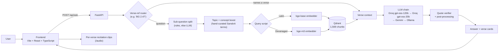

# VYOM

**Ask the Bhagavad Gita a question and get an answer grounded in its verses, with every quote checked against the text, and the verse recited aloud.**

VYOM is a retrieval-augmented question-answering app over all 701 verses of the Bhagavad Gita. It searches the verses and Swami Sivananda's commentary, writes an answer with an LLM, removes any quotation that isn't in the source text, and shows the cited verses as cards in Sanskrit, transliteration and English, each with its own recitation clip.

> **Recitation audio:** Bhagavad Gita recitation by Radha Gopinath Prabhu, published by Hare Krsna TV ([YouTube](https://www.youtube.com/watch?v=hHq14qUebOc)). VYOM cuts it into per-verse clips; all credit for the recitation belongs to them.

<!-- Demo GIF: replace with a recording of one question -> answer -> verse card -> clip playing -->


---

## Architecture



- **Answer cache:** repeated questions are answered from an in-process cache, with no LLM call.
- **Verifier:** runs on every answer, whichever provider wrote it.

## Features

- **Grounded answers.** One section per sub-question. Every teaching is cited as (BG x.y), and the model is told to cite only the verses it was shown.
- **Verified quotes.** A quoted passage of five or more words must match a translation or commentary excerpt shown to the model. Otherwise it is replaced with the best-matching translation, or its sentence is removed and the reader sees a warning.
- **Per-verse audio.** 700 verse clips and 18 chapter clips, cut from a full recitation by detecting slide changes in the video. Playback is exclusive and pauses the background music.
- **Sacred Book reader.** A chapter-by-chapter reader for all 18 chapters.
- **Sanskrit-aware retrieval.**
  - A hand-curated router maps 16 core terms (sthitaprajna, svadharma, gunas, atman and others) to their defining verses.
  - Spelling variants match: *sthita-prajñasya*, *Sthithaprajna*, *स्थितप्रज्ञ*.
  - Devanagari queries use a multilingual embedder.
- **Resilient generation.** A four-step provider chain with fast failover on rate limits, plus an answer cache for repeated demo questions.

## Key numbers

Every figure here comes from [docs/BENCHMARK.md](docs/BENCHMARK.md) or [docs/CHALLENGES_LOG.md](docs/CHALLENGES_LOG.md).

| What | Result |
|---|---|
| Prompt size per question (Groq, 3 sub-questions) | 4,972 → 2,665 tokens (**−46 %**), from removing a duplicated rule block and the Sanskrit/IAST from the LLM context |
| Failover | Groq gpt-oss-120b → Groq gpt-oss-20b → Gemini → Ollama. A 429 retries once only if `retry-after` ≤ 5 s, otherwise moves on at once. With Groq off, Gemini answered in 4.9 s |
| Retrieval, strict gold (20 questions) | dense bge-base hit@5 **0.85**, MRR@10 **0.82** vs bge-m3 0.85 / 0.71 (MRR +0.11, 95 % CI [+0.01, +0.22]) |
| Retrieval latency (CPU, median) | bge-base 33 ms, bge-m3 72 ms |
| Hybrid BM25 + dense | no configuration beat dense on hit@5; see [why](docs/CHALLENGES_LOG.md) |
| Backend tests | 330 passing |

Full results: six retrieval configurations scored against strict and lenient hand-judged gold, built from a blind pool of 225 verses. See [docs/BENCHMARK.md](docs/BENCHMARK.md).

## Running it

Requirements:
- Python 3.11+ with the backend packages below. In this repo, `venv/` is a conda environment at the root, so the interpreter is `venv\python.exe`.
- Node.js for the frontend.
- A Groq API key.

```powershell
npm install
```
```powershell
npm install --prefix frontend
```

Backend packages: `fastapi`, `uvicorn`, `pydantic`, `python-dotenv`, `qdrant-client`, `sentence-transformers`, `transformers`, `numpy`, `rank-bm25`, `groq`, `httpx`, plus `pytest` for the tests.

Put keys and settings in `backend/.env`; `backend/.env.example` shows the format.

**Both servers together (Windows).** Backend on :8000, frontend on http://localhost:5173; Vite proxies `/api` and `/audio`.

```powershell
npm run dev:win
```

**Backend only:**

```powershell
.\venv\python.exe -m uvicorn backend.api.main:app --host 127.0.0.1 --port 8000
```

**Frontend only:**

```powershell
npm run dev --prefix frontend
```

**Before a demo,** warm the answer cache with the demo questions. It sends the exact chip queries, 25 s apart, to stay under Groq's rate limit:

```powershell
.\venv\python.exe backend\scripts\warm_cache.py
```

**Tests and build:**

```powershell
.\venv\python.exe -m pytest backend/tests
```
```powershell
npm run build
```

### Rebuilding the index

Qdrant storage and embeddings are not in git. Rebuild them from the raw dataset in `backend/data/gita`. The Sanskrit corrections in `ingestion/clean.py` are applied automatically, and the chunk step reproduces `verses.jsonl` and `chunks.jsonl` byte for byte. Embedding runs on CPU and takes a few minutes per model.

```powershell
.\venv\python.exe backend\ingestion\chunk.py
```
```powershell
.\venv\python.exe backend\indexing\embed.py --model bge-base
```
```powershell
.\venv\python.exe backend\indexing\build_index.py --model bge-base
```
```powershell
.\venv\python.exe backend\indexing\embed.py --model bge-m3
```
```powershell
.\venv\python.exe backend\indexing\build_index.py --model bge-m3
```

Check that the raw pipeline matches the processed files:

```powershell
.\venv\python.exe -I backend\scripts\check_pipeline_repro.py
```

Then, with the backend stopped (local Qdrant allows one process), check the index itself: point counts, the corrected verses' stored text and a local retrieval smoke test, with no LLM calls:

```powershell
.\venv\python.exe -I backend\scripts\verify_reindex.py
```

Other utilities live in `backend/scripts/` too: `failover_check.py` (provider fallback), `measure_ask.py` (real-request tokens and latency), `hindi_check.py`, `concept_router_eval.py`, `hard_queries_latency.py`, `gemini_diag.py` and `groq_models.py`. API keys are read only from `backend/.env`.

### Audio clips

The recitation clips (700 verses + 18 chapters, from Radha Gopinath Prabhu's recitation published by **Hare Krsna TV**) are stored in **Git LFS**. After cloning, run:

```powershell
git lfs install
```
```powershell
git lfs pull
```

The backend serves them at `/audio` from `backend/data/multimodal/source/assets/audio/`; in development Vite proxies `/audio` to it. Without `git lfs pull` the files are small LFS pointer files and playback fails.

#### Rebuild the clips from the source recording (optional)

Only needed if the LFS copies are unavailable. The clips are cut from the source video with the hand-checked cut list `cuts_final.csv` (700 verses) and mapped to verses by `backend/data/multimodal/verse_clips.json`. Needs [yt-dlp](https://github.com/yt-dlp/yt-dlp) and ffmpeg on PATH. Run from `backend\data\multimodal\source`.

```powershell
yt-dlp -f "bv*+ba/b" --merge-output-format mp4 -o lecture.mp4 "https://www.youtube.com/watch?v=hHq14qUebOc"
```
```powershell
..\..\..\..\venv\python.exe ..\..\..\ingestion\gita_split.py split lecture.mp4 cuts_final.csv --chapters chapters.csv --out assets --dry-run
```
```powershell
..\..\..\..\venv\python.exe ..\..\..\ingestion\gita_split.py split lecture.mp4 cuts_final.csv --chapters chapters.csv --out assets
```

- **Output:** `assets/audio/verses/bg_CC_VV.mp3` and `assets/audio/chapters/bg_CC.mp3`, which the backend serves at `/audio`. File names follow the reciter's numbering, not verse IDs (see `verse_clips.json`).
- **Dry run first:** the first `split` command only prints the ffmpeg commands, so you can check them before writing anything.
- **OCR audit (optional):** the scripts in `backend/data/multimodal/source/_audit/` need Tesseract (`C:\Program Files\Tesseract-OCR`) with the Sanskrit and Hindi models `san.traineddata` and `hin.traineddata` from https://github.com/tesseract-ocr/tessdata, placed in that `_audit/` folder. They are not in git.
- **Re-deriving the cut list:** the cut times assume the same video timeline. Finding the cuts again from scratch (slide-change detection with `ingestion/gita_split_slides.py`, then the hand corrections in `corrections.json`) is a manual process.

### Environment variables

| Variable | Default | Purpose |
|---|---|---|
| `GROQ_API_KEY` | (none) | Primary LLM provider |
| `GROQ_MODEL` | `openai/gpt-oss-120b` | Main Groq model |
| `GROQ_FALLBACK_MODEL` | `openai/gpt-oss-20b` | Second Groq tier (`groq2`) |
| `LLM_PROVIDERS` | `groq,groq2,gemini,ollama` | Provider order |
| `GEMINI_API_KEY` | (none) | Gemini, called over REST |
| `GEMINI_MODEL` | `gemini-3.5-flash-lite` | Gemini model |
| `OLLAMA_URL` | `http://localhost:11434/api/generate` | Local fallback |
| `OLLAMA_MODEL` | `llama3.2` | Local model |
| `VYOM_EMBED_MODEL` | `bge-base` | Query embedder: `bge-base` or `bge-m3` |
| `VYOM_SCRIPT_ROUTING` | `1` | Send Devanagari queries to bge-m3 (`0` loads bge-base only) |
| `VYOM_CACHE_SIZE` | `128` | Entries in each in-process cache (`0` turns caching off) |
| `VYOM_AUDIO_DIR` | `backend/data/multimodal/source/assets/audio` | Folder served at `/audio` |

## Tech stack

- **Backend:** Python, FastAPI, Qdrant (local mode), sentence-transformers (BAAI bge-base-en-v1.5 and bge-m3), rank-bm25 (evaluated, not served), Groq SDK, httpx (Gemini REST and Ollama), pytest.
- **Frontend:** Vite, React 19, TypeScript, Tailwind CSS 4, lucide-react.
- **Audio pipeline:** ffmpeg scene detection, with verse boundaries taken from the video's slide changes (`backend/ingestion/gita_split_slides.py`).

## Data and audio attribution

- **Gita dataset:** <source — owner to confirm>
- **Text.** Sanskrit, transliteration, word meanings, translations and commentaries for all 701 verses.
  - English translators: Swami Sivananda, Swami Gambirananda, Swami Adidevananda, Shri Purohit Swami, Dr. S. Sankaranarayan.
  - Hindi translators: Swami Ramsukhdas, Swami Tejomayananda.
  - Commentators (16): Swami Sivananda (English); Swami Chinmayananda and Swami Ramsukhdas (Hindi); Sri Shankaracharya, Sri Ramanujacharya, Sri Madhavacharya, Sri Sridhara Swami, Sri Madhusudan Saraswati, Sri Abhinavgupta, Sri Anandgiri, Sri Dhanpati, Sri Jayatritha, Sri Neelkanth, Sri Purushottamji, Sri Vallabhacharya and Sri Vedantadeshikacharya Venkatanatha (Sanskrit).
  - Only Swami Sivananda's English commentary is indexed for retrieval.
- **Audio.** Verse and chapter clips are cut from the Bhagavad Gita recitation by Radha Gopinath Prabhu, published by Hare Krsna TV: https://www.youtube.com/watch?v=hHq14qUebOc
- **Fonts.** Cinzel, Plus Jakarta Sans and Tiro Devanagari Sanskrit, from Google Fonts.

## Known limitations

- **Quotes are verified; full faithfulness is not.** The quote verifier removes any quotation that isn't in the shown translations, and false-premise citations are stripped. But the explanation around a quote is the LLM's paraphrase and can drift from what the verse says. In multi-part answers, the "The Gita says nothing about X." sentence is not always placed at the start of the section that carries the premise.
- **Small evaluation set.** 24 questions, 20 of them scored. Most differences between configurations fall inside their confidence intervals.
- **Groq free-tier limits.** About 8K tokens per minute. A new question now sends about 2.9–3.4K prompt tokens plus 250–600 completion tokens, so roughly 2 new questions per minute; more than that falls back to the next provider. Repeated questions come from the in-process cache. For a demo, warm the cache first with `backend\scripts\warm_cache.py` (see Running it).
- **Hinglish in Latin script is not routed** to the multilingual embedder; only Devanagari is. Queries like "man ko shant kaise karein" retrieve poorly with either model.
- **Inconsistent Sanskrit spelling in the dataset's transliteration.** For example, ś is written "sh", and svadharma appears as both "sva-dharma" and "swa-dharma". This limits exact-term search. The concept router works around it for 16 core terms.
- **Hand-curated concept router.** It is curated by hand, so it covers only the terms in its map, and it is kept out of the benchmark numbers.
- **System prompt not trimmed.** It is about 2.2K tokens and still repeats a few rules (the quote format and the "Arjuna's despair" rule each appear twice). Removing the duplicates would save roughly 150–200 tokens per question; it was left as is when the code was frozen.

## More

- [docs/BENCHMARK.md](docs/BENCHMARK.md): retrieval evaluation, method and serving decision.
- [docs/CHALLENGES_LOG.md](docs/CHALLENGES_LOG.md): problems met, root causes, fixes, before/after numbers.
- [docs/PROJECT_HISTORY.md](docs/PROJECT_HISTORY.md): how the project got here, and why.
